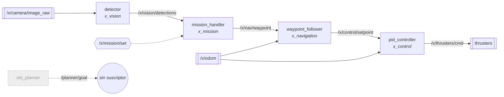
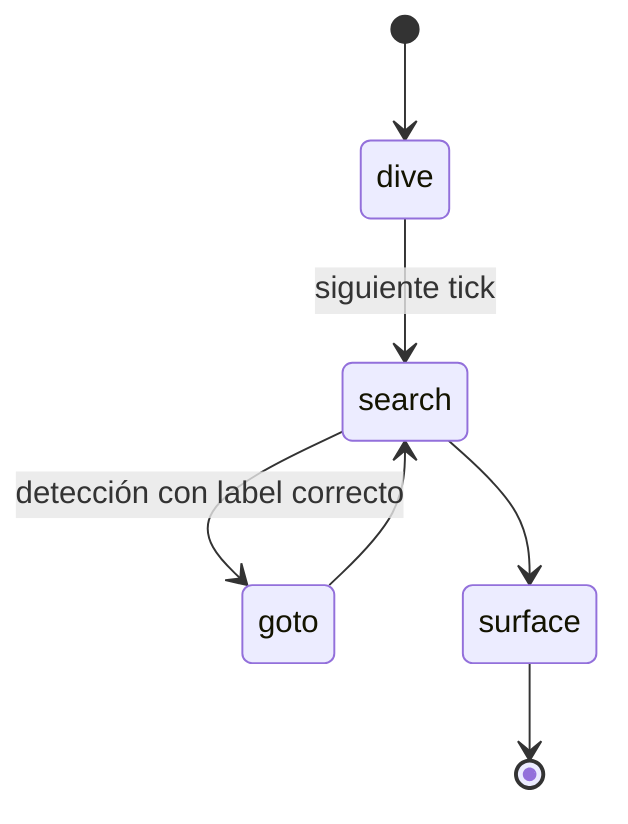

# Proyecto X · software del sub

Workspace ROS 2 del vehículo submarino X: misiones → navegación → control, con visión como sensor.

> **Estado:** simulación funcional · `real.launch.py` sin probar · detector sin modelo real

## Arquitectura



## Paquetes

| Paquete | Qué hace | Nodos | Estado |
|---|---|---|---|
| [`x_interfaces`](src/x_interfaces) | Mensajes `Waypoint`, `Detection` y servicio `SetMission` | — | ✅ en uso |
| [`x_mission`](src/x_mission) | Máquina de estados que recorre `missions/*.yaml` | `mission_handler` | ⚠️ avanza de paso sin esperar llegar |
| [`x_navigation`](src/x_navigation) | Convierte waypoints en setpoints suavizados | `waypoint_follower` | ✅ en uso |
| | | `old_planner` | 🪦 obsoleto, nadie lo lanza |
| [`x_control`](src/x_control) | PID de profundidad y yaw → 6 thrusters | `pid_controller` | ⚠️ yaw siempre 0 |
| [`x_vision`](src/x_vision) | Detección de compuerta/boya | `detector` | ⚠️ sin modelo ONNX |
| | | `camara_vieja` | 🪦 obsoleto |
| [`x_bringup`](src/x_bringup) | Launch files | — | `sim` ✅ · `real` ⚠️ |

## Cómo correrlo

<details>
<summary><b>1. Preparar</b> (rutas fijas que hay que cambiar)</summary>

- `src/x_navigation/config/nav.yaml` → `log_dir`
- `src/x_vision/config/vision.yaml` → `model_path`

</details>

<details>
<summary><b>2. Compilar y lanzar simulación</b></summary>

```bash
colcon build
source install/setup.bash
ros2 launch x_bringup sim.launch.py mission_file:=mission_1.yaml
```

Misiones disponibles en [`src/x_mission/missions`](src/x_mission/missions): `mission_1.yaml` (compuerta + boya), `mission_test.yaml` (cuadrado).

</details>

<details>
<summary><b>3. Cambiar de misión en caliente</b></summary>

```bash
ros2 service call /x/mission/set x_interfaces/srv/SetMission "{mission_file: mission_test.yaml}"
```

</details>

## Flujo de una misión



## Pendientes conocidos
- [ ] `mission_handler`: avanzar solo al llegar al waypoint
- [ ] `pid_controller`: calcular error de yaw
- [ ] `detector`: cargar modelo ONNX
- [ ] Borrar `old_planner` y `camara_vieja`
- [ ] Probar `real.launch.py`
