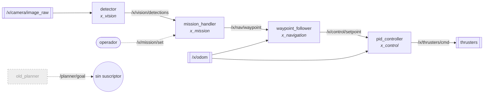

# Proyecto X · software del sub

Workspace ROS 2 del vehículo submarino X. Una misión en YAML decide a dónde ir, navegación suaviza el camino y un PID mueve los thrusters; visión aporta detecciones que hacen avanzar la misión.

> **Estado:** la simulación arranca, pero el sub solo controla la profundidad ([`pid_controller.cpp:25-30`](src/x_control/src/pid_controller.cpp#L25-L30)) · `real.launch.py` está sin probar ([`real.launch.py:1-2`](src/x_bringup/launch/real.launch.py#L1-L2)) · el detector no tiene modelo ([`detector.py:21`](src/x_vision/x_vision/detector.py#L21)). Detalle completo en [estado real del código](openwiki/operations/estado.md).

## Arquitectura



- Tabla de quién publica y quién escucha cada topic: [openwiki/architecture/topics.md](openwiki/architecture/topics.md).
- Diagrama interactivo (zoom, cada nodo enlaza a su código): [`docs/arch/arquitectura-proyecto-x.html`](docs/arch/arquitectura-proyecto-x.html). GitHub lo muestra como código: descárgalo con *Download raw file* y ábrelo en el navegador.

## Paquetes

| Paquete | Qué hace | Nodos | Estado |
|---|---|---|---|
| [`x_interfaces`](openwiki/packages/x_interfaces.md) | Mensajes `Waypoint`, `Detection` y servicio `SetMission` ([`CMakeLists.txt:6-11`](src/x_interfaces/CMakeLists.txt#L6-L11)) | — | ✅ en uso |
| [`x_mission`](openwiki/packages/x_mission.md) | Recorre los pasos de `missions/*.yaml` ([`mission_handler.py:43-60`](src/x_mission/x_mission/mission_handler.py#L43-L60)) | `mission_handler` | ⚠️ avanza sin esperar a llegar ([`mission_handler.py:58-60`](src/x_mission/x_mission/mission_handler.py#L58-L60)) |
| [`x_navigation`](openwiki/packages/x_navigation.md) | Convierte waypoints en setpoints ([`waypoint_follower.py:35-43`](src/x_navigation/x_navigation/waypoint_follower.py#L35-L43)) | `waypoint_follower` | ✅ en uso |
| | | `old_planner` | 🪦 obsoleto ([`old_planner.py:1-2`](src/x_navigation/x_navigation/old_planner.py#L1-L2)) |
| [`x_control`](openwiki/packages/x_control.md) | PID → 6 thrusters ([`pid_controller.cpp:23-31`](src/x_control/src/pid_controller.cpp#L23-L31)) | `pid_controller` | ⚠️ yaw = 0 y x/y ignorados ([`pid_controller.cpp:25-30`](src/x_control/src/pid_controller.cpp#L25-L30)) |
| [`x_vision`](openwiki/packages/x_vision.md) | Detección con la cámara frontal | `detector` | ⚠️ siempre devuelve `gate` ([`detector.py:23`](src/x_vision/x_vision/detector.py#L23)) |
| | | `camara_vieja` | 🪦 obsoleto ([`camara_vieja.py:1-2`](src/x_vision/x_vision/camara_vieja.py#L1-L2)) |
| [`x_bringup`](openwiki/packages/x_bringup.md) | Launch files | — | `sim` ✅ · `real` ⚠️ |

## Cómo correrlo

```bash
colcon build
source install/setup.bash
ros2 launch x_bringup sim.launch.py mission_file:=mission_1.yaml
```

<details>
<summary>Cambiar de misión en caliente</summary>

```bash
ros2 service call /x/mission/set x_interfaces/srv/SetMission "{mission_file: mission_test.yaml}"
```
El servicio vuelve a cargar la misión desde el paso 0 ([`mission_handler.py:32-38`](src/x_mission/x_mission/mission_handler.py#L32-L38)).
</details>

<details>
<summary>¿Hay que cambiar <code>/home/alberto</code> en los YAML?</summary>

Hoy no sirve de nada: ningún launch carga los archivos de `config/` ([`sim.launch.py:11-14`](src/x_bringup/launch/sim.launch.py#L11-L14)). Ver [configuración](openwiki/operations/running.md).
</details>

## Documentación

- **Sitio web:** el portal [`docs-site-lab`](https://github.com/cyuxSz/docs-site-lab) publica esta wiki con login. Cuando `openwiki/` o `docs/arch/` cambian en `main`, el workflow `notify-docs-site` le avisa para que se reconstruya.
- Wiki completa: [`openwiki/`](openwiki/index.md). Empieza por el [quickstart](openwiki/quickstart.md).
- Cada afirmación de este README y de la wiki cita `archivo:línea`. El workflow `wiki-claims` falla si el código citado cambia y la documentación no.
- Para validarla y actualizarla, usa `/actualizar-docs` en Claude Code.
