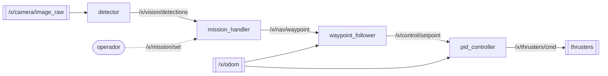

# Visión general

Diagrama interactivo equivalente: rama `docs/archify`, archivo `docs/arch/arquitectura-proyecto-x.html`.

## Cadena principal
1. `detector` recibe imágenes de `/x/camera/image_raw` y publica `Detection` en `/x/vision/detections` ([`detector.py:16-17`](../../src/x_vision/x_vision/detector.py#L16-L17)).
2. `mission_handler` escucha esas detecciones y publica `Waypoint` en `/x/nav/waypoint` ([`mission_handler.py:19-20`](../../src/x_mission/x_mission/mission_handler.py#L19-L20)).
3. `waypoint_follower` combina el waypoint con `/x/odom` y publica `PoseStamped` en `/x/control/setpoint` ([`waypoint_follower.py:19-21`](../../src/x_navigation/x_navigation/waypoint_follower.py#L19-L21)).
4. `pid_controller` combina el setpoint con `/x/odom` y publica 6 esfuerzos en `/x/thrusters/cmd` ([`pid_controller.cpp:14-18`](../../src/x_control/src/pid_controller.cpp#L14-L18)).

## Frecuencias
- `mission_handler` evalúa la misión cada 0.5 s ([`mission_handler.py:23`](../../src/x_mission/x_mission/mission_handler.py#L23)).
- `waypoint_follower` publica setpoints cada 0.1 s ([`waypoint_follower.py:22`](../../src/x_navigation/x_navigation/waypoint_follower.py#L22)).
- `pid_controller` corre cada 50 ms con `dt` fijo de 0.05 ([`pid_controller.cpp:19`](../../src/x_control/src/pid_controller.cpp#L19), [`pid_controller.cpp:24`](../../src/x_control/src/pid_controller.cpp#L24)).
